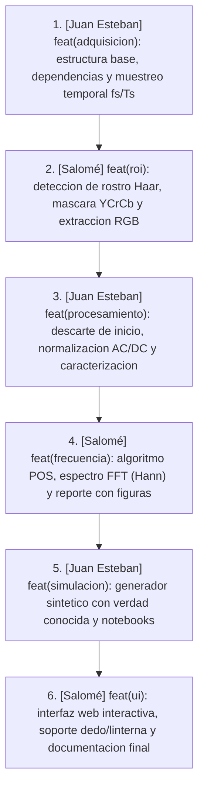

# Guía de Paquetes de Commits para Git (2 Personas × 3 Commits)

Este documento está diseñado para organizar la subida progresiva del proyecto en **6 commits grandes y coherentes**, alternando entre los dos integrantes del equipo:
- **Persona 1:** Juan Esteban Botero Sanchez (`jbotero109535@umanizales.edu.co`)
- **Persona 2:** Salomé Granada Henao (`sgranada111535@umanizales.edu.co`)

> **Instrucción para IA / Asistentes en otro dispositivo:**
> Si estás usando un asistente de IA (como Antigravity, Cursor o Copilot) en otro computador, solo dile:
> *"Por favor aplica el Paquete X de `docs/paquetes_commits.md`"* (donde X es del 1 al 6) y el asistente podrá ejecutar directamente el bloque correspondiente.

---

## Resumen del Flujo de Commits



---

## Paso Previo: Inicializar el Repositorio
Si el repositorio aún no tiene Git inicializado, corre:
```bash
git init
```

---

## 📦 Paquete 1: Adquisición y Muestreo Base
- **Autor:** Juan Esteban Botero Sanchez (`jbotero109535@umanizales.edu.co`)
- **Archivos que incluye:**
  - `.gitignore`
  - `requirements.txt`
  - `data/README.md`
  - `data/.gitkeep`
  - `src/__init__.py`
  - `src/config.py`
  - `src/video_io.py`
- **Comando exacto para aplicar:**
```bash
git add .gitignore requirements.txt data/README.md data/.gitkeep src/__init__.py src/config.py src/video_io.py

GIT_AUTHOR_NAME="Juan Esteban Botero Sanchez" GIT_AUTHOR_EMAIL="jbotero109535@umanizales.edu.co" \
GIT_COMMITTER_NAME="Juan Esteban Botero Sanchez" GIT_COMMITTER_EMAIL="jbotero109535@umanizales.edu.co" \
git commit -m "feat(adquisicion): inicializar estructura del proyecto y modulo de muestreo temporal (fs, Ts)"
```

---

## 📦 Paquete 2: Detección Facial y Extracción de Señales
- **Autora:** Salomé Granada Henao (`sgranada111535@umanizales.edu.co`)
- **Archivos que incluye:**
  - `src/roi.py`
  - `src/signal_extraction.py`
  - `docs/Especificaciones_Entrega_2_Teoria_Senales.pdf`
- **Comando exacto para aplicar:**
```bash
git add src/roi.py src/signal_extraction.py docs/Especificaciones_Entrega_2_Teoria_Senales.pdf

GIT_AUTHOR_NAME="Salomé Granada Henao" GIT_AUTHOR_EMAIL="sgranada111535@umanizales.edu.co" \
GIT_COMMITTER_NAME="Salomé Granada Henao" GIT_COMMITTER_EMAIL="sgranada111535@umanizales.edu.co" \
git commit -m "feat(roi): implementar deteccion de rostro Haar, mascara YCrCb y extraccion de series RGB"
```

---

## 📦 Paquete 3: Preprocesamiento y Caracterización Estadística
- **Autor:** Juan Esteban Botero Sanchez (`jbotero109535@umanizales.edu.co`)
- **Archivos que incluye:**
  - `src/preprocessing.py`
  - `src/analysis.py`
- **Comando exacto para aplicar:**
```bash
git add src/preprocessing.py src/analysis.py

GIT_AUTHOR_NAME="Juan Esteban Botero Sanchez" GIT_AUTHOR_EMAIL="jbotero109535@umanizales.edu.co" \
GIT_COMMITTER_NAME="Juan Esteban Botero Sanchez" GIT_COMMITTER_EMAIL="jbotero109535@umanizales.edu.co" \
git commit -m "feat(procesamiento): agregar descarte de inicio, normalizacion AC/DC, detrending y caracterizacion estadistica"
```

---

## 📦 Paquete 4: Algoritmo POS y Análisis en Frecuencia
- **Autora:** Salomé Granada Henao (`sgranada111535@umanizales.edu.co`)
- **Archivos que incluye:**
  - `src/bpm.py`
  - `src/plots.py`
  - `src/report.py`
  - `src/pipeline.py`
- **Comando exacto para aplicar:**
```bash
git add src/bpm.py src/plots.py src/report.py src/pipeline.py

GIT_AUTHOR_NAME="Salomé Granada Henao" GIT_AUTHOR_EMAIL="sgranada111535@umanizales.edu.co" \
GIT_COMMITTER_NAME="Salomé Granada Henao" GIT_COMMITTER_EMAIL="sgranada111535@umanizales.edu.co" \
git commit -m "feat(frecuencia): implementar algoritmo POS, analisis espectral con ventana Hann y generador de figuras con reporte"
```

---

## 📦 Paquete 5: Simulación Sintética y Resultados Base
- **Autor:** Juan Esteban Botero Sanchez (`jbotero109535@umanizales.edu.co`)
- **Archivos que incluye:**
  - `src/simulation.py`
  - `src/run_demo.py`
  - `notebooks/01_simulacion.ipynb`
  - `notebooks/02_video_real.ipynb`
  - `results/` (todas las figuras generadas, simvideo_reporte.md, simvideo_resultados.json y .gitkeep)
- **Comando exacto para aplicar:**
```bash
git add src/simulation.py src/run_demo.py notebooks/01_simulacion.ipynb notebooks/02_video_real.ipynb results/

GIT_AUTHOR_NAME="Juan Esteban Botero Sanchez" GIT_AUTHOR_EMAIL="jbotero109535@umanizales.edu.co" \
GIT_COMMITTER_NAME="Juan Esteban Botero Sanchez" GIT_COMMITTER_EMAIL="jbotero109535@umanizales.edu.co" \
git commit -m "feat(simulacion): incorporar generador sintético con verdad conocida, cuadernos de analisis y resultados base"
```

---

## 📦 Paquete 6: Interfaz Web y Documentación Final
- **Autora:** Salomé Granada Henao (`sgranada111535@umanizales.edu.co`)
- **Archivos que incluye:**
  - `src/web_app.py`
  - `src/web/index.html`
  - `src/web/static/style.css`
  - `src/web/static/app.js`
  - `docs/mapa_conceptos.md`
  - `docs/guia_sustentacion.md`
  - `docs/explicacion_detallada.md`
  - `docs/paquetes_commits.md`
  - `crear_commits.sh`
  - `README.md`
- **Comando exacto para aplicar:**
```bash
git add src/web_app.py src/web/ docs/mapa_conceptos.md docs/guia_sustentacion.md docs/explicacion_detallada.md docs/paquetes_commits.md crear_commits.sh README.md

GIT_AUTHOR_NAME="Salomé Granada Henao" GIT_AUTHOR_EMAIL="sgranada111535@umanizales.edu.co" \
GIT_COMMITTER_NAME="Salomé Granada Henao" GIT_COMMITTER_EMAIL="sgranada111535@umanizales.edu.co" \
git commit -m "feat(ui): anadir interfaz web interactiva, soporte de modo dedo/linterna y documentacion completa de entrega"
```

---

## Verificación Final del Historial

Para comprobar que los 6 commits quedaron registrados correctamente con sus respectivos autores:
```bash
git log --graph --pretty=format:'%h - %an <%ae>: %s (%cr)'
```

Para subir los cambios a tu repositorio remoto de GitHub (reemplaza con la URL de tu repo):
```bash
git remote add origin https://github.com/TU_USUARIO/TU_REPO.git
git branch -M main
git push -u origin main
```
