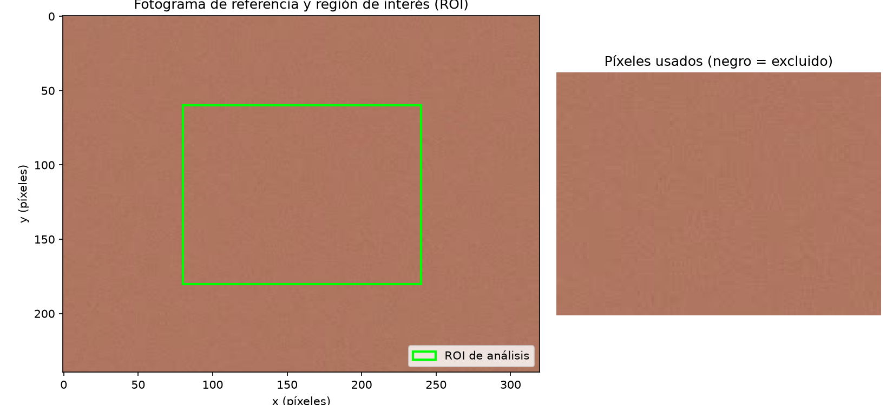
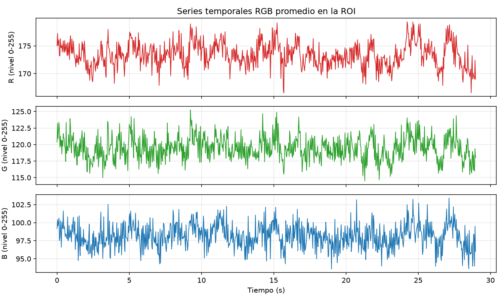
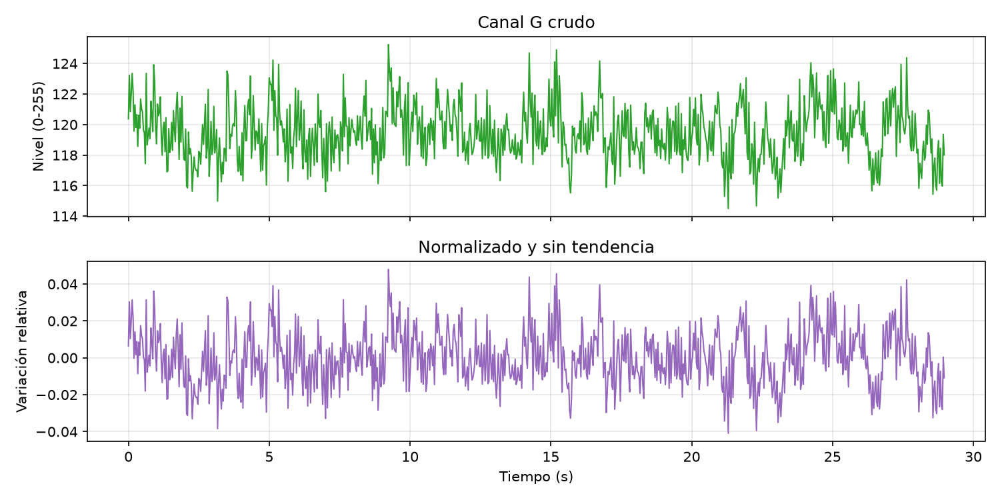
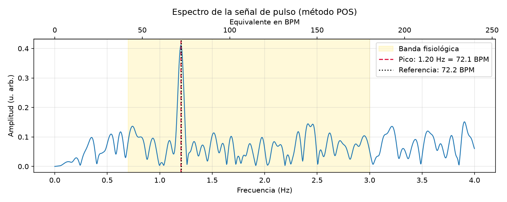
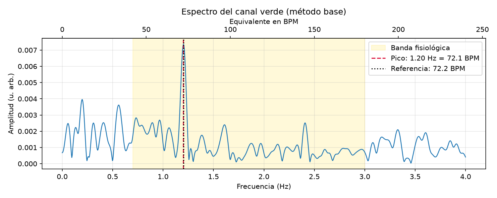
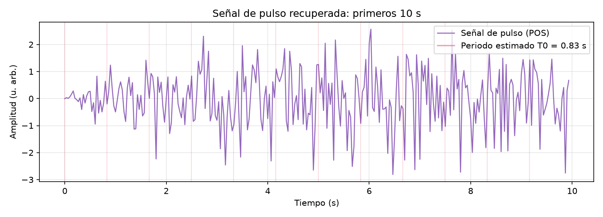
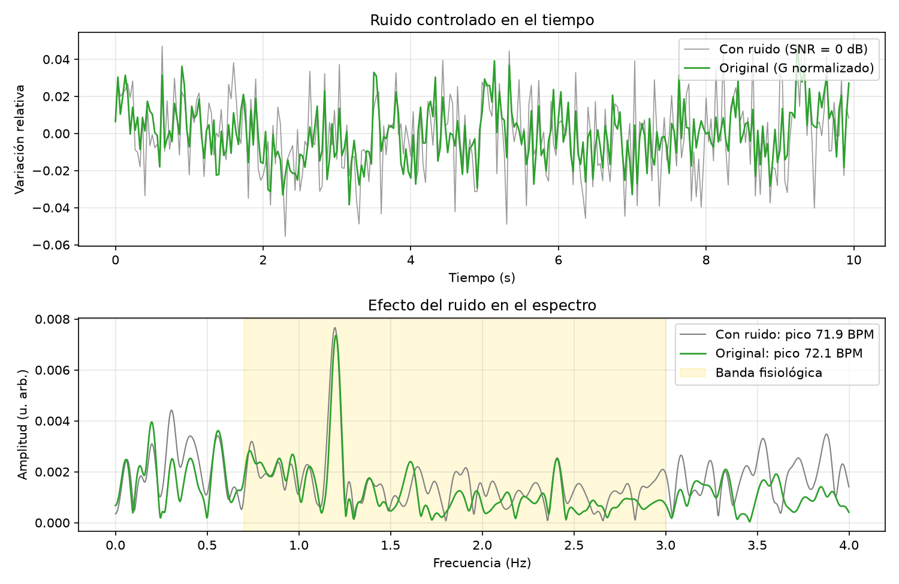

# Reporte rPPG - sim.avi

> Uso educativo. No es una medición clínica ni diagnóstica.

**Resumen:** BPM estimado (POS): 72.1 ± 1.0 BPM, confiabilidad media. Canal verde: 72.1 BPM. Referencia manual 72.2 BPM → error POS -0.1, verde -0.1 BPM.

## Adquisición

| Parámetro | Valor |
|---|---|
| fs = FPS | 30.000 Hz |
| Ts = 1/fs | 33.33 ms |
| Resolución | 320 × 240 px |
| Fotogramas | 900 |
| Duración total / útil | 30.0 s / 29.0 s |
| Nyquist fs/2 | 15.00 Hz |
| Resolución espectral 1/T | 2.07 BPM |

## Caracterización de las series R, G, B (niveles 0-255)

| Canal | N | mín | máx | pico a pico | media | desv. est. |
|---|---|---|---|---|---|---|
| R | 870 | 166.53 | 179.33 | 12.80 | 173.38 | 2.172 |
| G | 870 | 114.50 | 125.24 | 10.74 | 119.46 | 1.793 |
| B | 870 | 93.58 | 103.42 | 9.83 | 98.15 | 1.679 |

## 1. Región de interés (ROI)

La ROI se definió manualmente. Se usan 1 región(es) y la máscara de piel (espacio YCrCb) conserva 100 % de los píxeles. Solo se promedian píxeles de piel: cabello, cejas y fondo no contienen pulso y agregarían ruido. Verifique en la figura que el recuadro verde cae sobre piel.

## 2. Representación temporal: series R, G, B

Señal discreta muestreada a fs = 30.00 Hz (Ts = 33.3 ms), N = 870 muestras, duración útil 29.0 s (se descartaron los primeros 1.0 s por la auto-exposición). Niveles medios: R = 173.4, G = 119.5, B = 98.2 (escala 0-255). La variación pico a pico es pequeña respecto al nivel medio (R 7.4 %, G 9.0 %, B 10.0 %): el pulso es una variación de ~1 % montada sobre una componente DC grande. Deriva lenta a lo largo del video: R -0.64, G -0.29, B -0.29 niveles (cambios de luz o movimiento). Los saltos bruscos, si aparecen, suelen ser movimientos o ajustes de exposición.

## 3. Primera etapa de procesamiento

Se normalizó el canal verde por su media (x/media − 1, es decir AC/DC) y se quitó la tendencia lineal. La señal pasa de niveles absolutos (~119) a variación relativa centrada en cero (desviación ≈ 1.50 %). Así los canales son comparables, se elimina la componente DC (que dominaría el espectro en 0 Hz) y la deriva de -0.29 niveles.

## 4. Análisis frecuencial (POS)

La FFT (ventana de Hann, zero-padding ×8) muestra el contenido en frecuencia de la señal POS. Eje x: frecuencia en Hz (arriba en BPM = Hz × 60), de 0 a fs/2 = 15.0 Hz (Nyquist). Dentro de la banda fisiológica 0.7-3.0 Hz el pico dominante está en f0 = 1.201 Hz → 72.1 BPM. Calidad del pico 0.44 (confiabilidad media). Resolución espectral real Δf = 1/T = 0.034 Hz ≈ 2.1 BPM: el zero-padding solo interpola, no mejora este límite. En 2·f0 = 2.40 Hz hay una componente de 35 % de la amplitud del pico (armónico: el pulso es periódico pero no senoidal, serie de Fourier).

## 5. Análisis frecuencial (canal verde)

Con solo el canal verde (método base) el pico está en 1.201 Hz → 72.1 BPM (calidad 0.44). Diferencia con POS: +0.0 BPM; los dos métodos coinciden dentro de la resolución espectral, lo que da más confianza en la estimación. El verde es el canal más sensible a la hemoglobina; POS combina R, G y B para cancelar las variaciones de brillo comunes a los tres canales.

## 6. Señal de pulso recuperada

Forma de onda de la señal de pulso extraída con POS. Las líneas rojas marcan el periodo estimado T0 = 1/f0 = 0.83 s; en 10 s caben ≈ 12 ciclos. Si las oscilaciones siguen las líneas, la señal es casi periódica y el pico espectral corresponde a los latidos. Variaciones de amplitud o ciclos irregulares indican ruido residual o variación natural del ritmo (respiración).

## 7. Ruido / degradación controlada

Se sumó ruido blanco gaussiano a la señal G normalizada con SNR = 0 dB (σ = 1.50e-02, semilla 0). En el tiempo la forma del pulso se vuelve difícil de ver; en frecuencia el ruido blanco se reparte en todas las frecuencias y levanta el piso del espectro. El pico pasa de 72.1 a 71.9 BPM (-0.2) y la calidad de 0.44 a 0.42. Ruidos reales que afectan la señal: ruido del sensor y de cuantización (8 bits), compresión del video, movimiento de la cabeza, cambios y parpadeo de la iluminación (aliasing si la luz parpadea por encima de fs/2).
